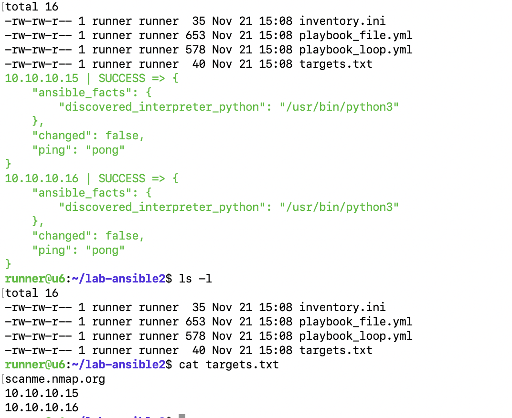
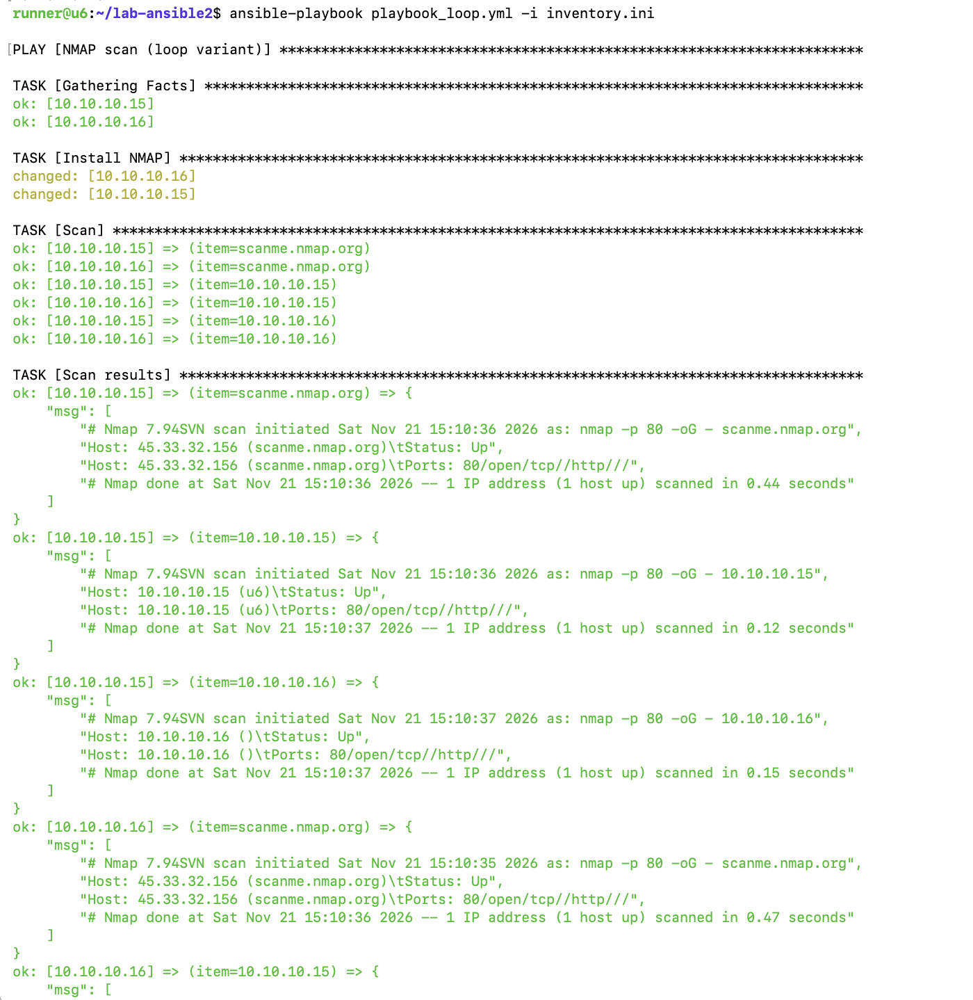
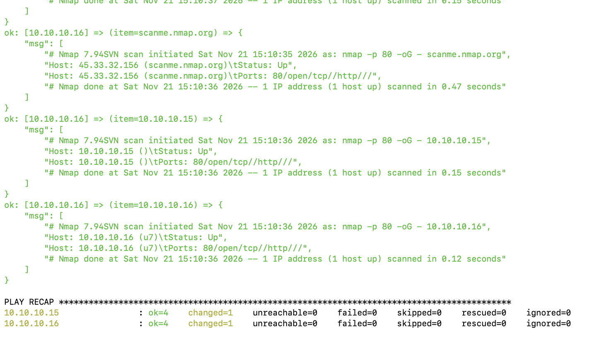
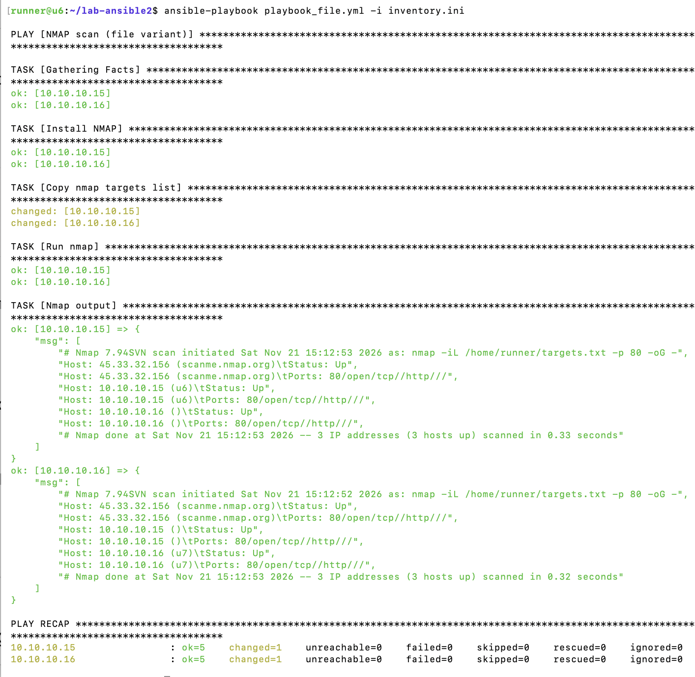

# Лабораторная П05. Работа с переменными в Ansible

## Файлы репозитория
- [`inventory.ini`](inventory.ini): инвентарь (группа `scanners`, два хоста)
- [`targets.txt`](targets.txt): список целей сканирования
- [`playbook_loop.yml`](playbook_loop.yml): вариант 2, цели передаются циклом
- [`playbook_file.yml`](playbook_file.yml): вариант 1, список копируется файлом
- `screenshots/`: скриншоты

## 1. Подготовка
На VM-1 создан каталог `~/lab-ansible2` с инвентарём, списком целей и двумя плейбуками. Доступность обоих хостов проверена модулем `ping`.

```ini
# inventory.ini
[scanners]
10.10.10.15
10.10.10.16
```

```
# targets.txt
scanme.nmap.org
10.10.10.15
10.10.10.16
```



## 2. Вариант 2: список целей читается локально и передаётся циклом
Файл `targets.txt` читается на управляющей машине функцией `lookup('file', './targets.txt').splitlines()`, а каждая цель по очереди подставляется в команду `nmap {{ item }} -p 80 -oG -`. Результаты накапливаются в переменной `scan_results` (`register`) и выводятся вторым циклом по `scan_results.results`.

```yaml
---
- name: NMAP scan (loop variant)
  hosts: scanners
  remote_user: runner
  become: true

  tasks:
  - name: Install NMAP
    ansible.builtin.apt:
      name: nmap
      state: present
      update_cache: true

  - name: Scan
    ansible.builtin.command: "nmap {{ item }} -p 80 -oG -"
    loop: "{{ lookup('file', './targets.txt').splitlines() }}"
    register: scan_results
    changed_when: false

  - name: Scan results
    ansible.builtin.debug:
      msg: "{{ item.stdout_lines }}"
    loop: "{{ scan_results.results }}"
    loop_control:
      label: "{{ item.item }}"
```

```bash
ansible-playbook playbook_loop.yml -i inventory.ini
```

На обоих хостах nmap установлен (`changed`), затем для каждой из трёх целей выполнен отдельный запуск (всего 6), результаты выведены по каждой цели отдельно. Порт 80 открыт на всех целях. В итоге `failed=0`, `unreachable=0`.





## 3. Вариант 1: список копируется файлом на хосты
Модуль `copy` копирует `targets.txt` на каждый целевой хост, затем nmap запускается один раз с ключом `-iL` (чтение целей из файла). Весь stdout сохраняется в `nmap_result` и выводится одним сообщением.

```yaml
---
- name: NMAP scan (file variant)
  hosts: scanners
  remote_user: runner
  become: true

  tasks:
  - name: Install NMAP
    ansible.builtin.apt:
      name: nmap
      state: present
      update_cache: true

  - name: Copy nmap targets list
    ansible.builtin.copy:
      src: ./targets.txt
      dest: /home/runner/targets.txt
      owner: runner
      group: runner
      force: true
      mode: '0644'

  - name: Run nmap
    ansible.builtin.command: "nmap -iL /home/runner/targets.txt -p 80 -oG -"
    register: nmap_result
    changed_when: false

  - name: Nmap output
    ansible.builtin.debug:
      msg: "{{ nmap_result.stdout_lines }}"
```

```bash
ansible-playbook playbook_file.yml -i inventory.ini
```

Установка показала `ok`, так как nmap уже был поставлен предыдущим плейбуком. Копирование списка дало `changed`, nmap запущен по одному разу на каждом хосте (всего 2). Результат тот же: все три цели доступны, порт 80 открыт. `failed=0`, `unreachable=0`.



## 4. Сравнение вариантов
| | Вариант 1 (файл) | Вариант 2 (цикл) |
|---|---|---|
| Где читается список целей | на целевом хосте, после копирования | на управляющей машине (`lookup('file')`) |
| Копирование файла | нужно (`copy`) | не нужно |
| Запусков nmap | 1 на хост (`-iL`), всего 2 | по числу целей на хост, всего 6 |
| Результат | один общий stdout на хост | отдельный результат на каждую цель (`scan_results.results`) |
| Вывод | `nmap_result.stdout_lines` | цикл по `scan_results.results` |
| Следы на сервере | файл со списком остаётся на хосте | нет |

Вариант с файлом быстрее и проще, так как сканер запускается один раз и сам разбирает список, а вариант с циклом удобнее, когда нужен отдельный результат по каждой цели или когда список целей не должен попадать на серверы.

## Выводы
Освоена передача данных в плейбук двумя способами: копированием файла на хосты и чтением файла на управляющей машине функцией `lookup` с последующей обработкой в цикле (`loop`). Результаты команд собираются в переменные директивой `register` и выводятся модулем `debug`.
